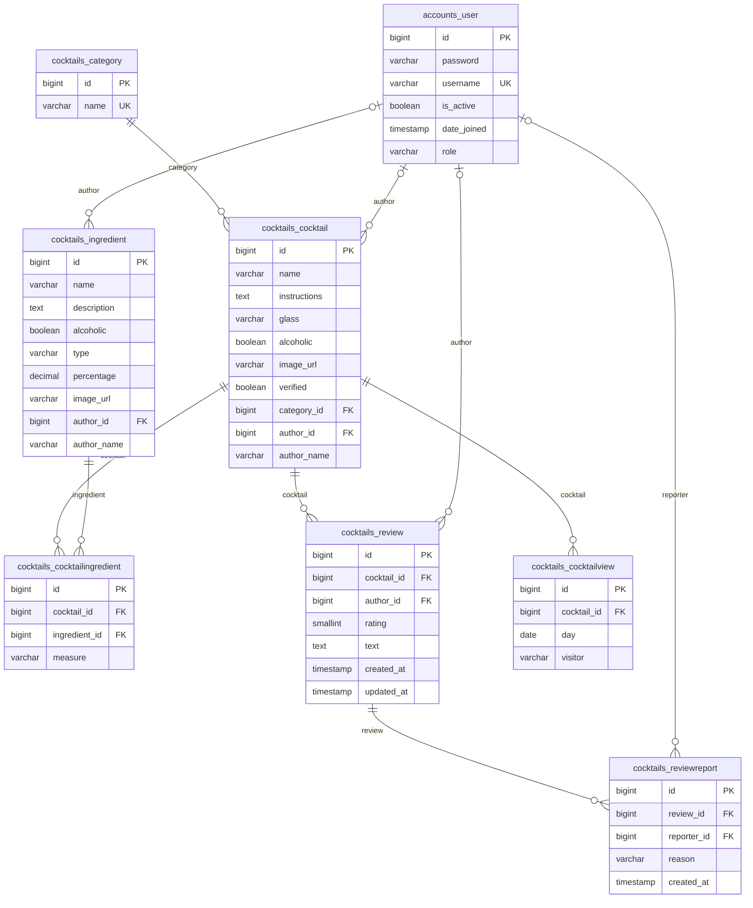

# Backend — API koktajli

REST API koktajli i składników. Django + Django REST Framework + PostgreSQL. Dane startowe pochodzą z publicznego API Solvro (220 koktajli, 552 składniki), a do tego są konta użytkowników z rolami, opinie, panel administracyjny (CMS) i etykiety popularności.

**Co jest w środku:**

- pełny CRUD koktajli i składników, paginacja, walidacja, filtrowanie i sortowanie (także „bezalkoholowe koktajle z miętą”)
- konta i logowanie JWT, cztery role (user, admin, staff, owner), autorzy treści, edycja tylko przez autora lub admina
- opinie z oceną 1-5, zgłaszanie opinii, znaczek „zweryfikowany”
- liczenie wyświetleń odporne na nabijanie oraz etykiety `trending`, `popular`, `most_popular`
- panel CMS (`/admin/`) z uprawnieniami zależnymi od roli
- dokumentacja Swagger/OpenAPI, diagram bazy danych, 200+ testów automatycznych

**Spis treści:** [Szybki start](#szybki-start) · [Pakiety](#pakiety) · [Schemat bazy danych](#schemat-bazy-danych) · [API](#api) · [Konta, role i uprawnienia](#konta-role-i-uprawnienia) · [CMS](#cms-panel-admin) · [Opinie](#opinie-i-oceny) · [Wyświetlenia i etykiety](#wyświetlenia-i-etykiety-popularności) · [Bezpieczeństwo](#bezpieczeństwo) · [Testy](#testy) · [Znane ograniczenia](#znane-ograniczenia)

## Szybki start

Potrzebne: Python 3.12+ i PostgreSQL.

```bash
cd backend
python -m venv .venv
# PowerShell:  Set-ExecutionPolicy -Scope Process -ExecutionPolicy RemoteSigned; .\.venv\Scripts\Activate.ps1
# Git Bash:    source .venv/Scripts/activate
pip install -r requirements.txt
cp .env.example .env                # uzupełnij SECRET_KEY, JWT_SIGNING_KEY i DB_PASSWORD
# w psql:  CREATE DATABASE cocktails;
python manage.py migrate
python manage.py import_solvro      # kopiuje koktajle i składniki z API Solvro (kilka sekund)
python manage.py createsuperuser    # pierwsze konto zostaje ownerem i wchodzi do /admin/
python manage.py runserver          # http://127.0.0.1:8000
```

Swagger: <http://127.0.0.1:8000/api/docs/> · CMS: <http://127.0.0.1:8000/admin/>

Zmienne w pliku `.env` (wszystkie sekrety zostają poza gitem):

| Zmienna | Znaczenie |
|---|---|
| `SECRET_KEY` | **wymagana**, długi losowy ciąg; bez niej Django nie wystartuje |
| `JWT_SIGNING_KEY` | **wymagana**, osobny od `SECRET_KEY` klucz do podpisywania tokenów, co najmniej 32 znaki (krótszy zatrzymuje start serwera) |
| `DB_PASSWORD` | **wymagana**, hasło użytkownika PostgreSQL |
| `DEBUG` | `true` tylko lokalnie; domyślnie wyłączone |
| `DB_NAME`, `DB_USER`, `DB_HOST`, `DB_PORT` | domyślnie `cocktails`, `postgres`, `localhost`, `5432` |
| `ALLOWED_HOSTS` | adresy po przecinku, domyślnie `localhost,127.0.0.1` |
| `CORS_ALLOWED_ORIGINS` | adresy frontendu, którym przeglądarka pozwoli czytać API (po przecinku), domyślnie `http://localhost:3000,http://127.0.0.1:3000`; dotyczy tylko `/api/` |
| `NUM_PROXIES` | ile serwerów pośredniczących stoi przed Django (domyślnie 0); ważne dla limitów i liczenia wyświetleń po IP |
| `TRENDING_MIN_VIEWS`, `POPULAR_MIN_VIEWS`, `MOST_POPULAR_MIN_VIEWS` | progi etykiet popularności (domyślnie 10 / 20 / 100) |

Import można uruchamiać wielokrotnie: zachowuje id z API Solvro, niczego nie dubluje, a przy błędzie sieci nie zostawia połowicznych danych.

## Pakiety

| Pakiet | Do czego |
|---|---|
| `django` | framework: modele, migracje, panel admina, URL-e |
| `djangorestframework` | zamienia modele w REST API (serializery, widoki, paginacja) |
| `django-filter` | filtrowanie list przez parametry URL-a (`?category=...`) |
| `psycopg` | sterownik PostgreSQL dla Django |
| `python-dotenv` | wczytuje sekrety z pliku `.env` (poza gitem) |
| `djangorestframework-simplejwt` | logowanie tokenami JWT (access + refresh, lista unieważnionych tokenów) |
| `django-cors-headers` | pozwala stronie frontendu z innego adresu czytać to API (CORS), tylko z wymienionych adresów |
| `drf-spectacular` | generuje dokumentację OpenAPI i stronę Swagger (`/api/docs/`) |
| `pytest`, `pytest-django` | testy automatyczne na prawdziwym PostgreSQL |

## Schemat bazy danych

Diagram jest wygenerowany z modeli Django (nie rysowany ręcznie), więc zgadza się z bazą. GitHub rysuje go automatycznie.



Jak czytać: `PK` klucz główny, `FK` klucz obcy, `UK` wartość unikalna. `||--o{` znaczy „jeden do wielu”, a `|o--o{` „zero lub jeden do wielu” (autor może być pusty).

| Relacja | Znaczenie |
|---|---|
| kategoria → koktajle | jedna kategoria ma wiele koktajli; kategorii z koktajlami nie da się usunąć (`PROTECT`) |
| koktajl ↔ składnik | wiele do wielu przez `cocktailingredient`, który trzyma też ilość (`measure`); składnika w użyciu nie da się usunąć (`PROTECT`) |
| użytkownik → koktajle, składniki, opinie, zgłoszenia | autor jest opcjonalny: dane z importu go nie mają, a po usunięciu konta pole się zeruje (`SET_NULL`), więc treść zostaje |
| koktajl → opinie, wyświetlenia | usunięcie koktajlu usuwa jego opinie i wyświetlenia (`CASCADE`) |
| opinia → zgłoszenia | usunięcie opinii usuwa jej zgłoszenia (`CASCADE`) |

Ograniczenia pilnowane przez samą bazę (nie tylko przez API):

| Tabela | Ograniczenie | Po co |
|---|---|---|
| `cocktailingredient` | unikalne `(cocktail, ingredient)` | ten sam składnik nie może wystąpić dwa razy w koktajlu |
| `review` | `rating` od 1 do 5 | ocena spoza zakresu jest odrzucana nawet z pominięciem API |
| `review` | unikalne `(author, cocktail)` | jedna opinia na użytkownika i koktajl |
| `reviewreport` | unikalne `(reporter, review)` | jedno zgłoszenie danej opinii przez jedną osobę |
| `cocktailview` | unikalne `(cocktail, day, visitor)` | jedno policzone wyświetlenie na odwiedzającego, koktajl i dzień |
| `cocktail` | indeks trigramowy `cocktail_name_trgm` | szybkie wyszukiwanie po fragmencie nazwy (patrz niżej) |

### Indeksy

| Indeks | Po co |
|---|---|
| klucze obce (automatyczne) | szybkie łączenie koktajli z kategorią i składnikami |
| B-tree na `Cocktail.name`, `Cocktail.glass`, `Ingredient.name` | sortowanie i filtrowanie po tych polach |
| unikalne `(cocktail, ingredient)` | brak duplikatów składnika w koktajlu; służy też jako indeks po koktajlu |
| trigramowy GIN na `UPPER(Cocktail.name)` | wyszukiwanie po fragmencie nazwy |

Django zamienia `name__icontains="marg"` na `UPPER(name) LIKE UPPER('%marg%')`, dlatego indeks trigramowy jest zbudowany na `UPPER(name)` (rozszerzenie `pg_trgm`, migracja `0002`). Zwykły indeks B-tree nie pomaga przy `LIKE '%fragment%'`.

Plan zapytania (`Cocktail.objects.filter(name__icontains="marg").explain(analyze=True)`):

```
Bitmap Heap Scan on cocktails_cocktail  (actual time=0.069..0.075 rows=3 loops=1)
  Recheck Cond: (upper((name)::text) ~~ '%MARG%'::text)
  ->  Bitmap Index Scan on cocktail_name_trgm  (actual time=0.038..0.038 rows=3 loops=1)
        Index Cond: (upper((name)::text) ~~ '%MARG%'::text)
Execution Time: 0.581 ms
```

Przy 220 koktajlach to tylko demonstracja: tabela mieści się w kilku stronach pamięci, więc nawet przeszukanie całej tabeli byłoby równie szybkie. Zysk byłby widoczny dopiero przy dziesiątkach tysięcy wierszy.

## API

Wszystkie adresy mają prefiks `/api/v1/`. Interaktywna dokumentacja (Swagger, z przyciskiem „Try it out”) jest pod `/api/docs/`, a surowy schemat OpenAPI pod `/api/schema/`. Generuje ją `drf-spectacular` z modeli, serializerów i filtrów; opisy parametrów pochodzą z `help_text` w `filters.py`. Strona Swaggera ładuje swój kod z CDN, więc wymaga internetu. Sprawdzenie schematu: `python manage.py spectacular --validate --fail-on-warn`.

| Zasób | Adresy |
|---|---|
| koktajle | `GET`, `POST /cocktails/` · `GET`, `PUT`, `PATCH`, `DELETE /cocktails/{id}/` |
| składniki | `GET`, `POST /ingredients/` · `GET`, `PUT`, `PATCH`, `DELETE /ingredients/{id}/` |
| kategorie | `GET /categories/` |
| opinie | `GET`, `POST /cocktails/{id}/reviews/` · `GET`, `PUT`, `PATCH`, `DELETE /reviews/{id}/` · `POST /reviews/{id}/report/` |
| wyświetlenia | `POST /cocktails/{id}/views/` |
| konta | `POST /auth/register/`, `/auth/login/`, `/auth/refresh/`, `/auth/logout/` · `GET /auth/me/` |

Kody odpowiedzi: 201 po utworzeniu, 204 po usunięciu, 400 dla złych danych lub parametrów (z komunikatem, które pole jest złe), 401 bez logowania, 403 bez uprawnień, 404 dla nieistniejącego zasobu, 409 przy konflikcie, 429 po przekroczeniu limitu.

### Koktajle

Przykładowa odpowiedź `GET /api/v1/cocktails/11000/` (skrócona):

```json
{
  "id": 11000, "name": "Mojito", "category": "Cocktail", "glass": "Highball glass", "alcoholic": true,
  "image_url": "https://cocktails.solvro.pl/images/cocktails/mojito.png", "verified": true,
  "rating_avg": null, "rating_count": 0, "views_14d": 0, "views_30d": 0, "status": null,
  "author": null, "author_name": "", "instructions": "Muddle mint leaves with sugar and lime j...",
  "ingredients": [
    {"id": 312, "name": "Lime", "alcoholic": false, "type": "Fruit", "percentage": null, "measure": "Juice of 1 ", "...": "..."},
    {"id": 337, "name": "Mint", "alcoholic": false, "type": "Flower", "percentage": null, "measure": "2-4 ", "...": "..."}
  ]
}
```

Lista (`GET /cocktails/`) zwraca po 20 na stronę w formacie `{count, next, previous, results}` (`?page=2`, `?page_size=50`, maksymalnie 100). Parametry listy łączą się ze sobą i z paginacją, a zła wartość daje 400:

| Parametr | Przykład | Znaczenie |
|---|---|---|
| `search` | `?search=marg` | fragment nazwy, bez rozróżniania wielkości liter |
| `category` | `?category=Shot` | dokładna nazwa kategorii |
| `glass` | `?glass=Jar` | dokładna nazwa szklanki |
| `alcoholic` | `?alcoholic=true` | tylko `true` lub `false` |
| `verified` | `?verified=true` | tylko zweryfikowane (lub `false`) |
| `author` | `?author=anna` | koktajle dodane przez to konto (bez rozróżniania wielkości liter) |
| `ingredient` | `?ingredient=mint,lime` | fragment nazwy składnika; po przecinku koktajl musi mieć wszystkie |
| `id` | `?id=11000,11007` | tylko te koktajle (ulubione); samo `?id=` = brak wyników |
| `status` | `?status=trending` | etykieta popularności: `trending`, `popular`, `most_popular` |
| `ordering` | `?ordering=-popular` | `name`, `id`, `verified`, `category`, `trending`, `popular`, `top_rated` (minus = malejąco); remisy rozstrzyga nazwa, potem `id` |

Przykład „bezalkoholowe koktajle z miętą”: `GET /api/v1/cocktails/?alcoholic=false&ingredient=mint`.

Zapis (wymaga zalogowania, nagłówek `Authorization: Bearer <access>`):

| Metoda i adres | Działanie | Odpowiedź |
|---|---|---|
| `POST /cocktails/` | utwórz | 201 + pełny koktajl |
| `PUT /cocktails/{id}/` | zastąp (wymagane `name`, `category`) | 200 |
| `PATCH /cocktails/{id}/` | zmień wybrane pola | 200 |
| `DELETE /cocktails/{id}/` | usuń (razem z jego składnikami) | 204 |

```json
{
  "name": "Test", "category": "Cocktail", "glass": "Tumbler", "alcoholic": false,
  "instructions": "Stir.", "image_url": "",
  "ingredients": [{"ingredient": 312, "measure": "2 oz"}, {"ingredient": 337}]
}
```

- `category` to **nazwa** istniejącej kategorii; nieznana nazwa = 400 (kategoria nie powstaje „przy okazji”).
- `ingredients`: lista `{ingredient: id, measure}`; nieznane id lub ten sam składnik dwa razy = 400. Wysłana lista **zastępuje** starą, pominięta zostawia ją bez zmian.
- Nazwa jest przycinana z białych znaków, niepusta, do 200 znaków; `image_url` musi być poprawnym adresem.
- Koktajl i jego składniki zapisują się w jednej transakcji.
- Autora ustawia serwer z konta w tokenie, a `verified` można zmienić tylko w CMS (żadne z nich nie jest przyjmowane z żądania).

### Składniki

| Metoda i adres | Działanie | Odpowiedź |
|---|---|---|
| `GET /ingredients/` | lista po 20 (`?page=`, `?page_size=` do 100) | 200 |
| `GET /ingredients/{id}/` | jeden składnik | 200 |
| `POST /ingredients/` | utwórz (wymagane `name`) | 201 |
| `PUT` / `PATCH /ingredients/{id}/` | zastąp / zmień wybrane pola | 200 |
| `DELETE /ingredients/{id}/` | usuń | 204; **409**, gdy składnik jest użyty w jakimś koktajlu |

Filtry listy: `?search=` (fragment nazwy), `?type=` (dokładny typ), `?alcoholic=true|false`, `?ordering=name|-name|id|-id`. Zła wartość daje 400.
Walidacja: `name` wymagane, do 200 znaków; `percentage` od 0 do 100; `image_url` musi być adresem.

## Konta, role i uprawnienia

Własny model użytkownika (`accounts.User`) z polem `role`: **user < admin < staff < owner**. Flagi Django (`is_staff` = wejście do panelu `/admin/`, `is_superuser` = tylko owner) są zawsze wyliczane z roli przy zapisie, więc nie mogą się z nią rozjechać. Konto z `createsuperuser` jest ownerem. Rejestracja zawsze tworzy zwykłego użytkownika; roli nie da się podać w żądaniu.

| Metoda i adres | Działanie |
|---|---|
| `POST /auth/register/` | `username` + `password` (hasło sprawdzane regułami Django; nazwy bez rozróżniania wielkości liter są unikalne) |
| `POST /auth/login/` | zwraca `access` (ważny 10 minut) i `refresh` (7 dni) |
| `POST /auth/refresh/` | nowy `access` i **nowy** `refresh`; stary przestaje działać |
| `POST /auth/logout/` | unieważnia `refresh` |
| `GET /auth/me/` | `id`, `username`, `role` (wymaga nagłówka `Authorization: Bearer <access>`) |

Rejestracja i logowanie mają wspólny limit 10 prób na minutę z jednego IP. Limit liczy adres z `REMOTE_ADDR`; za serwerem pośredniczącym (np. Cloud Run) trzeba ustawić zmienną `NUM_PROXIES`, inaczej limit będzie liczony po adresie pośrednika. Nie ma pola e-mail (mniej danych osobowych).

**Kto co może z koktajlami i składnikami:**

| Kto | Uprawnienia |
|---|---|
| każdy, także niezalogowany | czyta |
| zalogowany (`user`) | dodaje; zmienia i usuwa **tylko swoje** |
| `admin`, `staff`, `owner` | zmieniają i usuwają **wszystko**, także dane zaimportowane |

- Dane z importu Solvro nie mają autora (`author: null`, `author_name: ""`), więc zwykły użytkownik nie może ich zmienić.
- Autora ustawia serwer z konta w tokenie (`author` = id, `author_name` = kopia nazwy). Klient nie może go podać ani zmienić później; test pilnuje, żeby nie dało się „przejąć” cudzego wpisu przez PATCH.
- Po usunięciu konta treść zostaje: `author` staje się `null`, a `author_name` zachowuje starą nazwę. Taki wpis może już zmienić tylko admin wzwyż.
- Niezalogowany zapis daje 401, brak uprawnień 403.

**Zmiana modelu użytkownika wymaga świeżej bazy:** po pobraniu tej zmiany na istniejącej bazie `migrate` zgłosi niespójną historię migracji. Lokalnie: `DROP DATABASE cocktails; CREATE DATABASE cocktails;`, potem `migrate` i `import_solvro`.

## CMS (panel `/admin/`)

Panel administracyjny Django, ograniczony rolami. Wchodzą do niego tylko `admin`, `staff` i `owner` (zwykły użytkownik jest odsyłany do logowania). Pierwsze konto ownera: `python manage.py createsuperuser`.

| Co | Zasada |
|---|---|
| koktajle, składniki, kategorie | admin, staff i owner dodają, zmieniają i usuwają wszystko (składnik w użyciu jest chroniony) |
| konta użytkowników | zmieniać i usuwać można **tylko konta o niższej randze** niż własna; siebie ani równych sobie nie |
| nadawanie ról | **tylko rolę niższą od własnej**: admin tworzy zwykłych użytkowników, staff także adminów, owner także staff. Ownera nie da się nadać w panelu (tylko `createsuperuser`). |
| flagi `is_staff` / `is_superuser` | nie ma ich w formularzu; wynikają z roli przy zapisie |
| wpis dodany w panelu | dostaje autora z zalogowanego konta, tak jak przez API |
| opinie i zgłoszenia | admin je przegląda i usuwa, ale nie edytuje cudzych słów |

Rangi: user < admin < staff < owner. Nikt nie może edytować własnego konta w panelu ani innego ownera, żeby nie dało się wszystkich zablokować.

**Znaczek „zweryfikowany”.** Koktajl ma pole `verified`. To znaczek i filtr, nie bramka: **nic nie jest ukrywane**. Ustawia go ręcznie admin wzwyż w CMS (akcje „Mark selected cocktails as verified” i „Remove the verified mark”). Przez API nie da się go zmienić (nawet właścicielowi), więc autor nie może sam sobie go nadać. Dane z importu Solvro startują jako zweryfikowane, a ponowny import nie cofa decyzji admina.

## Opinie i oceny

| Metoda i adres | Działanie | Odpowiedź |
|---|---|---|
| `GET /cocktails/{id}/reviews/` | opinie o koktajlu, najnowsze pierwsze, po 20 | 200 (404, gdy nie ma koktajlu) |
| `POST /cocktails/{id}/reviews/` | dodaj swoją: `rating` 1-5 (liczba całkowita), `text` do 2000 znaków (opcjonalny) | 201; **409**, gdy już oceniłeś; **403**, gdy to Twój koktajl |
| `GET` / `PATCH` / `PUT /reviews/{id}/` | czytaj / zmień (tylko autor) | 200 |
| `DELETE /reviews/{id}/` | usuń: autor albo admin, staff, owner | 204 |
| `POST /reviews/{id}/report/` | zgłoś opinię adminowi (zalogowany, `reason` opcjonalny, do 300 znaków) | 201; 200 przy powtórzeniu |

- Każdy koktajl w liście i szczegółach ma `rating_avg` (średnia, 2 miejsca, `null` bez opinii) i `rating_count`.
- Opinię może dodać tylko zalogowany, jedną na koktajl (pilnuje tego też baza), nie o własnym koktajlu (autor mógłby sobie zawyżać ocenę).
- Admin **usuwa**, ale nie **edytuje** cudzych opinii; autor koktajlu może opinię tylko **zgłosić**, nie usunąć (inaczej kasowałby złe oceny).
- Po usunięciu konta opinia zostaje i nadal liczy się do średniej, a `author` oraz `author_username` mają wartość `null` (frontend pokazuje „usunięty użytkownik”).
- Zgłoszenia i opinie są w CMS (Reviews, Review reports): admin sortuje opinie po liczbie zgłoszeń i je usuwa albo odrzuca zgłoszenie (usuwa samo zgłoszenie). Opinii w CMS nie da się edytować.

## Wyświetlenia i etykiety popularności

`POST /cocktails/{id}/views/` liczy wyświetlenie (frontend woła to raz po otwarciu strony szczegółów). Zawsze odpowiada **204** (404 dla nieistniejącego koktajlu), także gdy wyświetlenie się nie liczy, żeby skrypt nie mógł sprawdzać, które wywołania podziałały. Odczyt (`GET`) niczego nie zmienia.

**Ochrona przed nabijaniem (poziom 1):**

| Atak | Obrona |
|---|---|
| tryb incognito, czyszczenie ciasteczek, zmiana przeglądarki | odwiedzający jest rozpoznawany **tylko po adresie IP**, nigdy po ciasteczku ani user-agencie |
| odświeżanie, skrypt z jednego komputera | jeden policzony odwiedzający na koktajl i dzień (unikalny wpis w bazie, `INSERT ... ON CONFLICT DO NOTHING`) oraz limit 30 wywołań na minutę na IP (429) |
| zmiana adresu w obrębie swojej sieci IPv6 | IPv6 liczone po prefiksie `/64`; `::ffff:1.2.3.4` to ten sam odwiedzający co `1.2.3.4` |
| podrobiony nagłówek `X-Forwarded-For` | ignorowany, dopóki `NUM_PROXIES` = 0; za serwerem pośredniczącym trzeba ustawić poprawną liczbę (test pilnuje obu przypadków) |
| autor „nakręca” własny koktajl | wyświetlenia zalogowanego autora koktajlu się nie liczą |

W bazie nie ma adresów IP: zapisujemy skrót HMAC z sekretu, dnia, koktajlu i sieci IP. Nie da się go cofnąć do adresu ani połączyć tej samej osoby między dniami i koktajlami.

**Etykieta `status`** jest liczona przy każdym zapytaniu z liczby unikalnych odwiedzających (bez zapisanego stanu). Progi to wartości demo, w `settings.LABEL_THRESHOLDS` (zmienne środowiskowe `TRENDING_MIN_VIEWS`, `POPULAR_MIN_VIEWS`, `MOST_POPULAR_MIN_VIEWS`):

| `status` | Reguła |
|---|---|
| `trending` | co najmniej 10 wyświetleń w ostatnich 14 dniach **i** ostatnie 7 dni mają więcej wyświetleń niż 7 dni wcześniej (nadal rośnie) |
| `popular` | nie `trending`, co najmniej 20 wyświetleń w ostatnich 30 dniach |
| `most_popular` | co najmniej 100 wyświetleń w ostatnich 30 dniach |

Pokazywana jest jedna etykieta, w kolejności: `trending`, `most_popular`, `popular`. W odpowiedzi są też liczby: `views_14d`, `views_30d`, `rating_avg`, `rating_count`.

**Sortowanie:** `-trending` (przyrost: ostatnie 7 dni minus 7 dni wcześniej), `-popular` (wyświetlenia z 30 dni), `-top_rated` (średnia ważona: koktajl z mniej niż 5 opiniami jest ściągany w stronę średniej wszystkich ocen, więc jedna piątka nie wygrywa z dwudziestoma ocenami po 4,8).

## Bezpieczeństwo

### Limity zapytań (rate limiting)

Limity są liczone na adres IP (niezalogowani) albo na konto (zalogowani). Przekroczenie daje **429** z nagłówkiem `Retry-After` (za ile sekund wrócić).

| Co | Limit | Zakres |
|---|---|---|
| wszystkie żądania niezalogowanych | 120 na minutę | adres IP |
| wszystkie żądania zalogowanych | 300 na minutę | konto |
| **zapisy** (POST, PUT, PATCH, DELETE: koktajle, składniki, opinie, zgłoszenia) | 30 na minutę | konto; jeden licznik na wszystkie endpointy |
| rejestracja i logowanie | 10 na minutę | adres IP |
| odświeżanie i unieważnianie tokenu | 30 na minutę | adres IP |
| liczenie wyświetleń | 30 na minutę | adres IP |
| logowanie do panelu `/admin/` | 10 prób na minutę | adres IP (własny middleware, bo panel jest poza DRF) |

Wartości są w `settings.py`. Test przypina rzeczywiste liczby, żeby nikt nie poluzował limitów przypadkiem.

Do wiedzenia:

- Adres IP bierzemy z `REMOTE_ADDR`; nagłówek `X-Forwarded-For` jest ignorowany, dopóki `NUM_PROXIES` wynosi 0 (test sprawdza, że podrobiony nagłówek nie omija limitu).
- DRF sprawdza uprawnienia **przed** limitami, więc żądania bez logowania odrzucone kodem 401 nie są liczone. Nic się wtedy nie zapisuje, a odczyty bez logowania są limitowane normalnie.
- Liczniki leżą w pamięci procesu serwera. Przy jednym procesie (lokalnie) działa to dokładnie, ale przy kilku procesach lub serwerach limity się mnożą. Na produkcji trzeba współdzielonego cache (np. wbudowany `DatabaseCache`, bez nowych pakietów).

### Uwierzytelnianie i hasła

- **Blokada konta:** po 5 nieudanych logowaniach dla jednej nazwy użytkownika (z dowolnego adresu IP, w oknie 15 minut od pierwszego błędu) kolejne próby dostają **429** z `Retry-After: 900`, nawet z poprawnym hasłem. Udane logowanie zeruje licznik, a próby w trakcie blokady jej nie przedłużają. Blokada działa tak samo dla nazw, które nie istnieją, więc nie zdradza, które konta są prawdziwe, a wielkość liter w nazwie nie pozwala obejść licznika. Limit 10 prób na minutę na IP (patrz wyżej) tego nie zastępuje: botnet może zgadywać hasło jednego konta z wielu adresów.
- **Cena blokady:** ktoś może celowo zablokować cudze konto na 15 minut, wpisując 5 razy złe hasło. Tak działa każda blokada, a jej brak zostawia zgadywanie haseł bez ograniczeń.
- **Hasła:** od 10 do 128 znaków; odrzucane są hasła z listy popularnych, same cyfry i hasła zbyt podobne do nazwy użytkownika. Maksimum chroni przed marnowaniem czasu na hashowanie gigantycznych tekstów. W bazie jest tylko hash (PBKDF2, 1,5 mln iteracji), nigdy hasło.
- **Tokeny JWT:** podpisywane osobnym kluczem `JWT_SIGNING_KEY` (nie `SECRET_KEY` Django), algorytm HS256 przypięty na stałe. Token z innym algorytmem (`none`, `HS512`), z podmienioną treścią albo podpisany `SECRET_KEY` jest odrzucany (401). Token dostępu żyje 10 minut, odświeżający 7 dni; przy każdym odświeżeniu dostajesz nowy, a stary przestaje działać, wylogowanie unieważnia bieżący.
- Odpowiedź na logowanie jest taka sama dla złego hasła i nieistniejącego użytkownika.
- **Dziennik zdarzeń** (logger `security`, standardowe wyjście): nieudane, zablokowane i udane logowania, odmowy dostępu (403) i przekroczone limity (429), z adresem IP i numerem konta. **Nigdy nie zawiera haseł ani wpisanych nazw**, bo ludzie czasem wklejają hasło w pole nazwy. Komunikaty w dzienniku nie mają polskich znaków, żeby nie psuły się w narzędziach z innym kodowaniem.

### Wstrzykiwanie SQL i zabezpieczenie wejścia

- **SQL injection:** cały dostęp do bazy idzie przez ORM Django, który przekazuje wartości jako parametry zapytania, nigdy nie sklejając ich w tekst SQL. W naszym kodzie nie ma `raw()`, `extra()` ani ręcznego `execute` z danymi od użytkownika (jedyne `execute` w poleceniu importu wykonuje SQL wygenerowany przez samo Django). Wartości `ordering`, `status`, `alcoholic` i `verified` są dodatkowo ograniczone do listy dozwolonych. Znaki `%` i `_` w wyszukiwaniu są traktowane dosłownie.
- **Limity wejścia** (żeby jedno żądanie nie zlecało bazie dowolnie dużo pracy; zła wartość daje 400):

| Co | Limit |
|---|---|
| `search`, `category`, `glass`, `type` | do 100 znaków |
| `author` | do 150 znaków (długość nazwy użytkownika) |
| `ingredient` | do 10 składników po 100 znaków |
| `id` | do 200 wartości |
| `instructions` (koktajl) | do 5000 znaków |
| `description` (składnik) | do 10000 znaków (najdłuższy opis z importu ma ok. 7000) |
| `ingredients[]` w koktajlu | do 50 wierszy (największy koktajl ma dziś 10) |
| całe żądanie | do 100 000 bajtów, inaczej 413 (sprawdzane po `Content-Length`, zanim ciało zostanie przeczytane) |

### XSS (wstrzykiwanie skryptów)

- API odpowiada wyłącznie JSON-em (`application/json` z `X-Content-Type-Options: nosniff`), a wersja HTML („browsable API” DRF) jest wyłączona. Przeglądarka nie wykona zawartości JSON-a.
- **Treść od użytkowników jest zapisywana bez zmian** (nie „czyścimy” jej po cichu), a bezpieczeństwo zapewnia kodowanie przy wyświetlaniu: React koduje wszystko, we frontendzie nie ma `dangerouslySetInnerHTML` ani `innerHTML`, a panel `/admin/` ma automatyczne kodowanie szablonów Django. Test sprawdza, że `` wraca jako zwykły tekst w JSON-ie.
- `image_url` musi zaczynać się od `https://` (odrzucane: `http:`, `ftp:`, `javascript:`, `data:`, adresy bez schematu). Zdjęcia z obcych hostów frontend dodatkowo pomija.
- Nie ustawiamy nagłówka `Content-Security-Policy` dla API: odpowiedzi JSON nie są wykonywane przez przeglądarkę, a `nosniff` jest tu standardową obroną. CSP ma sens dla stron HTML (frontend, panel).

## Testy

```bash
python -m pytest              # 272 testy, kilka sekund, bez internetu
python -m pytest -m network   # dodatkowo test na prawdziwym API Solvro (ok. 12 s, wymaga internetu)
```

Testy używają osobnej, tymczasowej bazy `test_cocktails` (tworzy ją i usuwa pytest-django), więc dane w bazie `cocktails` nie są ruszane. Zakres: filtry i paginacja, tworzenie, edycja i usuwanie z walidacją, reguła 409 przy usuwaniu używanego składnika, konta i tokeny, macierz uprawnień (niezalogowany, użytkownik, autor, każda rola admina), reguły CMS, opinie i zgłoszenia, liczenie wyświetleń z ochroną przed nabijaniem, etykiety i sortowania oraz import.

Import jest sprawdzany dwojako, z różnych powodów:

| Test | Co sprawdza | Kiedy |
|---|---|---|
| na atrapie API | **naszą logikę**: te same id co w Solvro, ponowny import nic nie zmienia, licznik id, składnik bez `measure`, brak połowicznych danych przy błędzie | zawsze |
| na prawdziwym API | **świat zewnętrzny**: dane Solvro nadal mają kształt, jakiego oczekuje import | tylko na życzenie (`-m network`) |

Testy były też sprawdzane „od drugiej strony”: kod był celowo psuty w kilkudziesięciu miejscach (np. wyłączenie reguły uprawnień albo ochrony przed nabijaniem), żeby upewnić się, że któryś test się wtedy wywala. Dzięki temu wiadomo, że testy naprawdę coś pilnują.

## Znane ograniczenia

- **Równoległa edycja:** wysłana lista `ingredients` zastępuje całą starą. Gdy dwie osoby edytują ten sam koktajl jednocześnie, wygrywa ostatni zapis (bez blokady optymistycznej). Ryzyko jest małe, bo edytować może tylko autor lub admin. „Książkowym” rozwiązaniem byłoby pole `updated_at` i nagłówek `If-Match` (odpowiedź 412 przy nieaktualnej wersji).
- **Brak weryfikacji e-mail** (w ogóle nie ma e-maila), więc skrypt może powoli zakładać wiele kont. Rejestracja jest ograniczona limitem 10 prób na minutę z jednego IP.
- **Limity w pamięci procesu:** patrz „Limity zapytań” wyżej; na produkcji potrzebny jest współdzielony cache. To dotyczy też liczników blokady konta.
- **Blokada konta** pozwala celowo zablokować cudze konto na 15 minut (patrz „Uwierzytelnianie i hasła”).
- **Wyświetlenia z wielu adresów IP** (botnet, rotujące VPN-y): każdy adres dodaje jedno wyświetlenie dziennie. Realna obrona to CAPTCHA albo proof-of-work (np. Cloudflare Turnstile), poza zakresem. Wspólny adres (szkoła, biuro) liczy się jako jeden odwiedzający, więc raczej zaniżamy niż zawyżamy.
- **Etykiety bez „pamięci”:** `trending` jest liczone z bieżących liczb, więc koktajl nie wie, że był trendujący od 14 dni. Dokładny zegar wymagałby zapisanego stanu i codziennego zadania. Progi 10 / 20 / 100 to wartości demo.
- **Wydajność etykiet:** liczby są liczone przy każdym zapytaniu o listę (kilka podzapytań na koktajl). Dla 220 koktajli to bez znaczenia; przy dużo większej bazie trzeba by je zapisywać (cache lub tabela zbiorcza). Tabela wyświetleń rośnie; wpisy starsze niż 30 dni nie są potrzebne do etykiet i można je kasować.
- **Swagger** ładuje swój kod z CDN, więc strona `/api/docs/` wymaga internetu.
- **Backend nie jest wdrożony:** działa lokalnie. Do publikacji brakuje produkcyjnych ustawień (pliki statyczne, serwer aplikacji, sekrety w zmiennych środowiskowych, `NUM_PROXIES`).
- Dane z API Solvro są importowane bez zmian, także ich błędy (np. część flag alkoholu jest nieprawdziwa).
